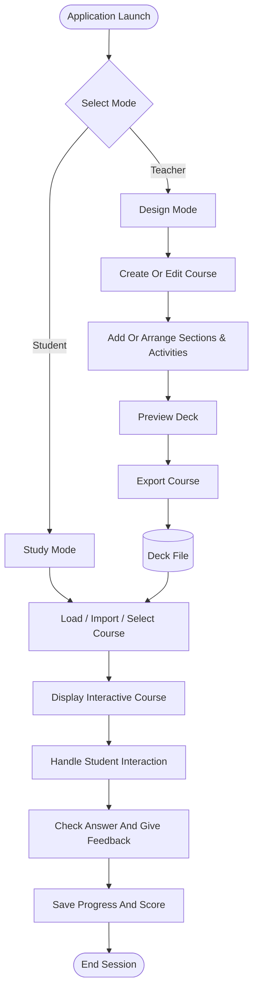

%%{init: {'theme': 'dark'}}%%
# Sifu - A Scalable Interactive Learning Platform

## Basic Flow of the Program

## Problems Being Addressed

1. **Lack of Interactive Learning Experiences:** Traditional learning methods rely heavily on text-based content, which can make learning less engaging and limit students' opportunities for hands-on practice.

2. **Limited Availability of Free Interactive Learning Platforms:** Existing platforms, such as Brilliant, provide interactive learning experiences, but there is a need for a free and accessible alternative for both teachers and students.

3. **Difficulty in Creating Interactive Lessons:** Teachers need an easy-to-use tool to create, organize, customize, and manage interactive lessons without requiring programming knowledge.

4. **Lack of Self-Paced Learning Opportunities:** Students need the flexibility to learn at their own pace, revisit lesson content, practice concepts, and study independently according to their individual needs.

5. **Lack of Immediate Feedback:** Students may struggle to identify their mistakes and understand concepts when learning activities do not provide instant feedback.

6. **Insufficient Learning Progress Tracking:** Students need a way to save their progress and scores, resume lessons from where they left off, and monitor their learning achievements over time.

7. **Limited Reusability and Sharing of Educational Content:** Teachers need a way to save, share, and reuse interactive lesson materials to reduce repeated preparation efforts and make educational resources more accessible.

8. **Limited Flexibility for Future Educational Needs:** There is a need for a scalable learning platform that can accommodate additional interactive activities, educational materials, subjects, and learning requirements in the future.